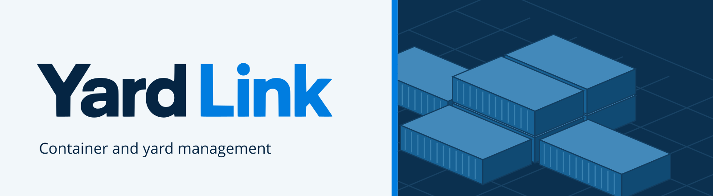

<picture>
  <source media="(prefers-color-scheme: dark)" srcset="assets/yard-link/README-Dark.svg">
  
</picture>

# Yard Link

Container and yard management for drayage fleets. Drivers work their trips from an iPhone. Dispatchers run the desk from a web console. Your company hosts its own server, so your data stays with you.

| Web dispatcher console | iPhone app |
| :---: | :---: |
|  |  |

## What's included

- **Trips:** pickups, drop-offs, swaps, chassis handling and change requests, all tracked on one timeline.
- **Equipment history:** every container's history is grouped by duty cycle, so a reused container number starts clean. Chassis keep their own continuous history.
- **Dispatch tasks and messages:** assign work to drivers, track steps, and keep one conversation per driver.
- **Locations and yard:** search any container or chassis, see what is on site, and keep location notes.
- **Time cards and documents:** driver time cards and trip documents are stored on your server.
- **Camera number reading:** the server reads container numbers from photos. No outside recognition service is used.

## Deploy with Dokploy

Yard Link runs as one Docker Compose stack: the web app, a PostgreSQL 17 database, and a one-time step that generates passwords. You do not write a `.env` file. Setup happens in the web app.

**Before you start**

- A server running [Dokploy](https://dokploy.com) with Docker.
- A domain name (for example `yard.example.com`) with a DNS `A` record pointing at your Dokploy server.
- This repository connected to your Dokploy server through GitHub.

**1. Create the service**

1. In Dokploy, open or create a **Project**, then click **Create Compose Service**.
2. Under **Provider**, choose **GitHub** and select your account and the `yardlink` repository.
3. Set **Branch** to `main`.
4. Set **Compose Path** to `./web/docker-compose.yml`.
5. Save.

**2. Add your domain**

1. Open the **Domains** tab of the compose service.
2. Add your host, for example `yard.example.com`.
3. Set the **Service** to `app` and the **Port** to `3847`.
4. Turn on HTTPS and save.

**3. Deploy**

1. Click **Deploy** and wait for the build to finish. The first build takes several minutes because it installs the OCR and browser components.
2. Open `https://yard.example.com` in a browser. The setup wizard appears.
3. Enter your company details, create the first dispatcher account, and confirm the server address. Everything can be changed later under **Settings**.

**Updating**

Push to `main`, then click **Deploy** in Dokploy again. You can also set up Dokploy's GitHub webhook for automatic deploys.

**Backups**

Back up these three Docker volumes:

| Volume | Holds |
| :--- | :--- |
| `yardlink-db` | The database |
| `yardlink-data` | Photos and documents |
| `yardlink-secrets` | Generated passwords. The database cannot be read without them. |

## Connecting phones

Settings in the web console shows a QR code with your server address and company name. There are no passwords in the code. Drivers open the Yard Link iPhone app, tap **Connect to Your Employer**, scan the code, and sign in. New drivers create an account with the join code shown beside the QR code, and a dispatcher approves them under **Drivers**.

The iPhone app reaches your server over HTTPS, which the domain above provides.

## Developing

```bash
cd web
npm install --legacy-peer-deps
```

Run a local database, then the app (from `web/`):

```bash
docker compose up -d db secrets
export DATABASE_URL=postgresql://yardlink:$(docker compose exec db cat /run/yardlink/db-password)@localhost:5432/yardlink
export NUXT_SESSION_PASSWORD=$(openssl rand -hex 32)
npm run db:migrate
npm run dev
```

Checks:

```bash
npm test
npm run typecheck
npm run lint
```

The iPhone app lives in [`ios/`](ios). Open `ios/YardLink.xcodeproj` in Xcode on a Mac.

## Repository layout

| Path | Contents |
| :--- | :--- |
| [`web/`](web) | Server, web console, database migrations, Dockerfile and `docker-compose.yml` |
| [`ios/`](ios) | The native SwiftUI iPhone app. It holds no business rules and calls the server. |
| [`docs/`](docs) | Feature reference |
| [`assets/`](assets) | Logos and brand files |
